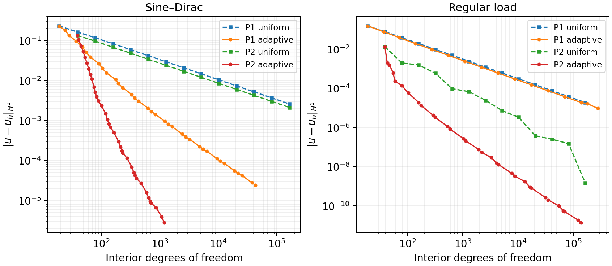

# Beyond the Obstacle

Victor Sieber · Numerical Practicum · University of Zurich

Where does a loaded string touch a rigid obstacle? This project computes its shape and tests two ways of reducing the work: placing more mesh points where the string changes slope, and using a coarse solution to guess which points will touch on the next grid.

## What the experiments show

| Question | Observation |
| --- | --- |
| Where should mesh points go? | For the string with point loads (sine–Dirac), quadratic elements on an adaptive mesh give a slope error of **2.77 × 10⁻⁶ with 1,195 unknowns**. The nearest recorded uniform mesh has **1,279 unknowns and error 2.41 × 10⁻²**. |
| Does the previous grid help find contact? | On the same 1,280-element fine grid, the sine–Dirac P1 solve takes **234 iterations** from a cold start, **177** when transferring the shape, and **5** when transferring both shape and supporting forces. All three reach the same solution within 10⁻⁸ at the nodes. |
| Is transferring the force always worthwhile? | For P2 under the regular load the corresponding counts are **487, 3 and 9**. Here the shape alone gives the best starting guess as measured by iterations. |
| Can the indicator stop the contact iteration early? | On all **174 mesh solves** in the eight convergence runs, the recorded stopping reason was a stable contact set. The tested inner threshold of 10⁻³ produced no early exits. |



The slope error is the H¹ seminorm of the difference between the computed and reference shapes. The two other convergence plots give the displacement error and the computed error indicator. [All four report figures](figures/key/inner_study/budget_300000/final/)

## How the calculation works

At contact the gap is zero, and away from contact the obstacle exerts zero force. The primal–dual active-set method (PDAS) uses these two conditions to update its guess for the contact nodes. P1 joins nodal heights with straight lines. P2 also uses an element midpoint and allows curvature. The adaptive method bisects intervals where the computed force imbalance or a change of slope makes the local indicator large. Reference solutions are used afterwards to evaluate accuracy.

For the regular load the reference contact interval starts at about 0.42139863. The directory name `no_exact` dates from before this reference was derived. On very fine grids solver precision can affect measured accuracy. A controlled example and its limits are described in the [precision diagnostic](docs/PRECISION_DIAGNOSTIC.md). In particular P2 enforces the obstacle at nodes and can dip below it between nodes. The indicator has been tested numerically for these two problems.

## Reproduce the handout results

Run from the repository root with Python 3.10 or later and the dependencies in `requirements.txt`.

```bash
python -m pip install -r requirements.txt
python -m experiments.key.final_delivery check
python -m experiments.key.final_delivery plots
```

The plotting command reads recorded CSVs and draws all four experiment figures without a new PDE solve. The two introductory sketches are drawn by the handout's LaTeX source. For independent checks run:

```bash
python -m experiments.validation.solvers.final_checks
python -m experiments.validation.estimators.verify_gap_sine_integration
python -m experiments.validation.solvers.submission_checks
```

The last command repeats the 1,280-element comparisons and writes a machine-specific check record. The [final protocol](FINAL_EXPERIMENTS.md) gives the commands for recomputing the studies and the mesh limits for each case. Iterations and recorded timings measure different things. The timings exclude the common coarse solve.

| Resource | Where to look |
| --- | --- |
| Eight convergence histories and per-run settings | [Canonical dataset](results/key/inner_study/budget_300000/) |
| Iterations and timings on identical fine grids | [Warm-start table](results/key/inner_study/budget_300000/warm_starts_inner.csv) |
| Summary of mesh sizes, errors and stop reasons | [Verified summary](results/key/inner_study/budget_300000/verified_summary.csv) |
| FEM, refinement and transfer code | [src](src/) and [experiment drivers](experiments/key/) |
| Precision checks and original histories before the P1 fix | [Validation evidence](results/validation/submission/) |

The earlier `final_study` and `budget_200` runs use other settings. For the handout use the `budget_300000` series above. The separate American-option and local-LLM work in [american_options](american_options/README.md) is an independent extension outside the practicum benchmarks.

The [audit](docs/INDEPENDENT_AUDIT.md) and its artifact hashes document the November 18 review. The handout and plotting entry point were subsequently revised.
