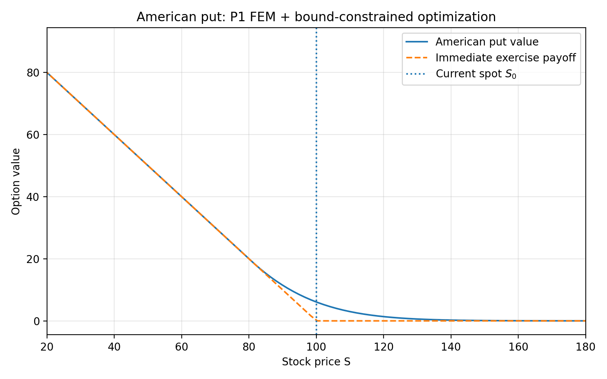
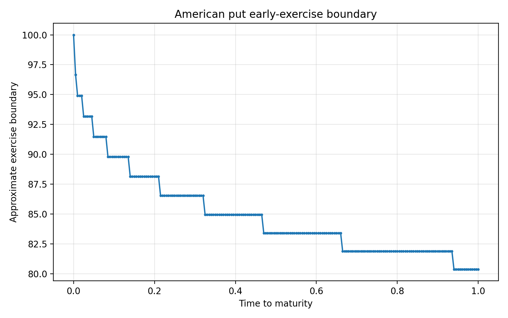
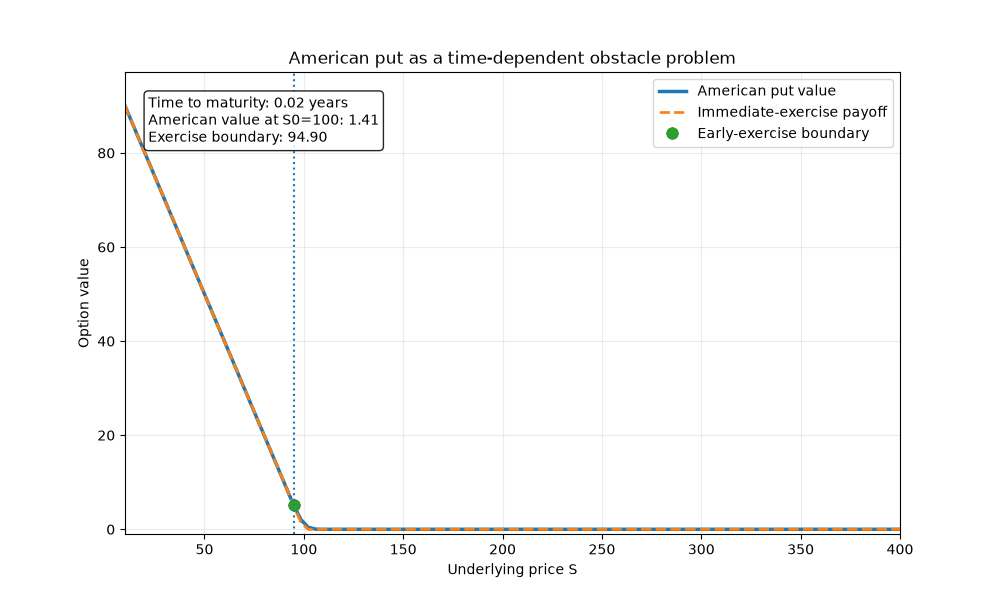

# Finite Element Methods for Obstacle Problems and American Optimal Stopping

Numerical Practicum project at the University of Zurich.

The core project develops finite element methods for one-dimensional obstacle problems, starting from the variational inequality and the resulting finite-dimensional complementarity problem.

> **Scope.** The American option pricing and local LLM components are self-directed extensions outside of the Numerical Practicum.

## Project overview

### Numerical Practicum core

The current project includes:

- P1 and P2 finite element discretizations for one-dimensional obstacle problems,
- primal-dual active-set (PDAS) solution of the discrete complementarity problem,
- comparison of PDAS with L-BFGS-B,
- validation against exact obstacle-problem solutions,
- $L^2$ and $H^1$-seminorm convergence experiments,
- aligned and non-aligned smooth benchmark cases,
- singular-load experiments with Dirac delta forcing,
- P1-P2 comparisons under smooth and reduced-regularity settings.

### Current / upcoming work

- test a local P1 jump indicator for adaptive mesh refinement,
- investigate coarse-to-fine / nested initialization of PDAS,
- compare adaptive and uniform refinement if the indicator is useful,
- consolidate the numerical experiments and prepare the final presentation.


## Continuous obstacle problem

Let $[a,b]$ be a bounded interval. We consider the energy functional

$$J(v)=\frac{1}{2}\int_a^b |v'(x)|^2\,dx-\int_a^b f(x)v(x)\,dx.$$

The admissible set is

$$K=\{v\in H_0^1(a,b):v\geq\psi\}.$$

The obstacle problem is to find

$$u=\mathop{\mathrm{argmin}}_{v\in K}J(v).$$

The corresponding variational inequality is

$$\int_a^b u'(x)(v-u)'(x)\,dx\geq\int_a^b f(x)(v-u)(x)\,dx\quad\text{for all }v\in K.$$

Formally, the obstacle problem satisfies

$$u-\psi\geq0,\qquad -u''-f\geq0,\qquad (u-\psi)(-u''-f)=0.$$

In the free region, where $u>\psi$,

$$-u''=f.$$

In the contact region,

$$u=\psi.$$

## P1 finite element discretization

Let

$$a=x_0<x_1<\cdots<x_N=b$$

be a partition of the interval into $N$ finite elements.

The discrete space consists of continuous piecewise-linear functions that vanish at the boundary.

Let $\lambda_1,\ldots,\lambda_{N-1}$ denote the nodal hat functions associated with the interior nodes.

A discrete function is written as

$$v_h(x)=\sum_{i=1}^{N-1}V_i\lambda_i(x).$$

Because $\lambda_i(x_j)=\delta_{ij}$, the coefficients are the values at the interior mesh nodes:

$$V_i=v_h(x_i).$$

## Discrete obstacle

The obstacle is approximated by its piecewise-linear nodal interpolant $\psi_h=I_h\psi$.

At the interior nodes, define $\Psi_i=\psi(x_i)$.

The obstacle constraint becomes

$$V_i\geq\Psi_i,\qquad i=1,\ldots,N-1.$$

For P1 finite elements, these nodal inequalities are sufficient to enforce the inequality against the piecewise-linear interpolated obstacle on each element.

## Matrix formulation

Substituting the finite element expansion into the energy functional gives

$$J(v_h)=\frac{1}{2}V^TAV-F^TV.$$

The stiffness matrix is defined by $A_{ij}=\int_a^b\lambda_i'(x)\lambda_j'(x)\,dx$.

The load vector is defined by $F_i=\int_a^b f(x)\lambda_i(x)\,dx$.

For a uniform mesh with mesh size $h=(b-a)/N$, the stiffness matrix is tridiagonal with diagonal entries $A_{ii}=2/h$ and neighboring off-diagonal entries $A_{i,i+1}=A_{i+1,i}=-1/h$.

The discrete obstacle problem is

$$\min_{V\geq\Psi}\left(\frac{1}{2}V^TAV-F^TV\right).$$

Its discrete complementarity conditions are

$$V-\Psi\geq0,\qquad AV-F\geq0,$$

together with

$$(V_i-\Psi_i)(AV-F)_i=0$$

for every interior node $i$.

The vector $AV-F$ is the discrete weak residual associated with the continuous reaction term $-u''-f$. At a free node the residual vanishes, while at a contact node it may be positive.

## Benchmark problem

The implementation is tested on the benchmark discussed in the Numerical Practicum.

The domain is $[0,1]$ and the load is

$$f(x)=-1.$$

For $0<\alpha<1/2$, the obstacle is

$$\psi(x)=x(1-x)-\frac{3}{2}\alpha^2.$$

The exact solution is defined piecewise.

For $0\leq x<\alpha$,

$$u(x)=\frac{x^2}{2}+(1-3\alpha)x.$$

For $\alpha\leq x\leq1-\alpha$,

$$u(x)=\psi(x).$$

For $1-\alpha<x\leq1$,

$$u(x)=\frac{(1-x)^2}{2}+(1-3\alpha)(1-x).$$

The exact contact region is

$$[\alpha,1-\alpha].$$

Because an exact solution is available, the finite element approximation can be validated directly.

## Numerical experiments

`experiments/run_example.py` solves the benchmark problem for a fixed mesh and compares:

- the exact solution,
- the P1 finite element approximation,
- the obstacle.

`experiments/convergence.py` repeats the computation for increasingly fine meshes and evaluates the numerical error.

For the benchmark with $\alpha=0.2$, the experiments give approximately

$$\|u-u_h\|_{L^2}=O(h^2)$$

and

$$|u-u_h|_{H^1}=O(h).$$

### Self-directed extensions (outside the Numerical Practicum)

- American put option pricing using the obstacle-problem framework,
- numerical recovery of the early-exercise boundary and validation against a Cox-Ross-Rubinstein benchmark,
- a local tool-using LLM interface built on top of deterministic option analytics.

## Self-directed extension: American option pricing

The American-option extension applies the same obstacle-problem framework to optimal stopping.

For an American put with payoff $g(S)=\max(K-S,0)$, the option value satisfies the obstacle condition $V(t,S)\geq g(S)$.

In the continuation region, where $V(t,S)>g(S)$, the Black-Scholes pricing PDE holds. In the exercise region, $V(t,S)=g(S)$. The interface between these regions is the free boundary and represents the optimal early-exercise boundary.

The implementation transforms the Black-Scholes problem to log-price coordinates, applies P1 finite elements in space and implicit Euler in time, and solves a bound-constrained convex quadratic optimization problem at each time step.

For the benchmark parameters $S_0=100$, $K=100$, $r=0.05$, $\sigma=0.20$, and $T=1$, the current implementation produces an American put value of approximately $6.09$, compared with a European Black-Scholes value of approximately $5.57$.

The American solver was independently checked against a 5000-step Cox-Ross-Rubinstein tree. Under joint mesh and time refinement, the FEM price approaches the numerical reference closely, although the difference is not monotone under joint refinement.

See [`american_options/README.md`](american_options/README.md) for the financial formulation, validation, and implementation details.

## Numerical results

| American put value and payoff | Early-exercise boundary |
| --- | --- |
|  |  |

The American option value stays above the immediate-exercise payoff. The recovered free boundary separates the exercise and continuation regions.

## Visual intuition: obstacle structure and time to maturity

The animation below shows numerical American put solutions for increasing times to maturity.

Close to expiration, the option value approaches the immediate-exercise payoff. With more time remaining, continuation value develops and the option value separates from the payoff over a larger region.

The marked contact point is the estimated early-exercise boundary. It separates the exercise region, where the option value coincides with the payoff, from the continuation region, where retaining the option is more valuable than exercising immediately.



## Self-directed extension: Local LLM analytics layer

The American-option extension also contains a local tool-using LLM interface.

The design principle is simple:

> The numerical solver is the quantitative source of truth. The language model is the interaction layer.

The architecture is:

```text
User question
    |
    v
Local LLM
Ollama + qwen3:8b
    |
    v
Tool selection
american_options/ai_assistant.py
    |
    v
Deterministic analytics
american_options/analytics.py
    |
    +-- price_option
    +-- compare_scenarios
    +-- sweep_parameter
    +-- analyze_exercise_boundary
    +-- get_model_information
    |
    v
Validated numerical engine
american_options/american_option.py
    |
    v
Structured numerical result
    |
    v
Natural-language explanation
```

Example questions include:

- "What numerical model do you use and how has it been validated?"
- "Price an American put with spot 100, strike 100, volatility 20%, rate 5%, and one year to maturity."
- "What happens if volatility rises from 20% to 30% while everything else stays the same?"

The LLM is instructed to call deterministic tools for quantitative option results rather than inventing prices.

Input validation is handled by the deterministic analytics layer. For example, invalid inputs such as negative volatility are rejected before reaching the numerical solver.

The current interface runs locally and does not require a paid external LLM API.

## Project structure

```text
obstacle-problem-fem/
├── src/                  # FEM assembly, problem definitions, solvers
├── experiments/          # core convergence, solver, P1/P2, and Dirac experiments
├── figures/              # generated figures
├── results/              # numerical output tables
├── american_options/     # self-directed finance and LLM extensions
├── README.md
├── requirements.txt
└── .gitignore
```

The Numerical Practicum core is contained in `src/`, `experiments/`, `figures/`, and `results/`. The `american_options/` directory is a separate self-directed extension.

## Running the code

Create and activate a virtual environment:

```bash
python -m venv .venv
source .venv/bin/activate
```

Install the Python dependencies:

```bash
pip install -r requirements.txt
```

Run the obstacle-problem benchmark:

```bash
python experiments/run_example.py
```

Run the obstacle-problem convergence study:

```bash
python experiments/convergence.py
```

Run the American put example:

```bash
python american_options/experiments/run_american_put.py
```

Run the American put validation study:

```bash
python american_options/experiments/convergence_validation.py
```

Generate the American-option animation:

```bash
python american_options/experiments/make_exercise_animation.py
```

## Running the local LLM interface

The LLM layer uses Ollama with the local `qwen3:8b` model.

Install Ollama separately, then pull the model:

```bash
ollama pull qwen3:8b
```

Start the local Ollama service:

```bash
ollama serve
```

In another terminal, activate the Python environment and start the assistant:

```bash
source .venv/bin/activate
python american_options/experiments/run_ai_assistant.py
```

The local language model selects deterministic pricing and analytics tools. Quantitative option results are produced by the numerical engine rather than by the LLM itself.

## Requirements

Python dependencies:

- NumPy
- SciPy
- Matplotlib
- Ollama Python client

The optional local LLM interface additionally requires:

- Ollama
- `qwen3:8b`